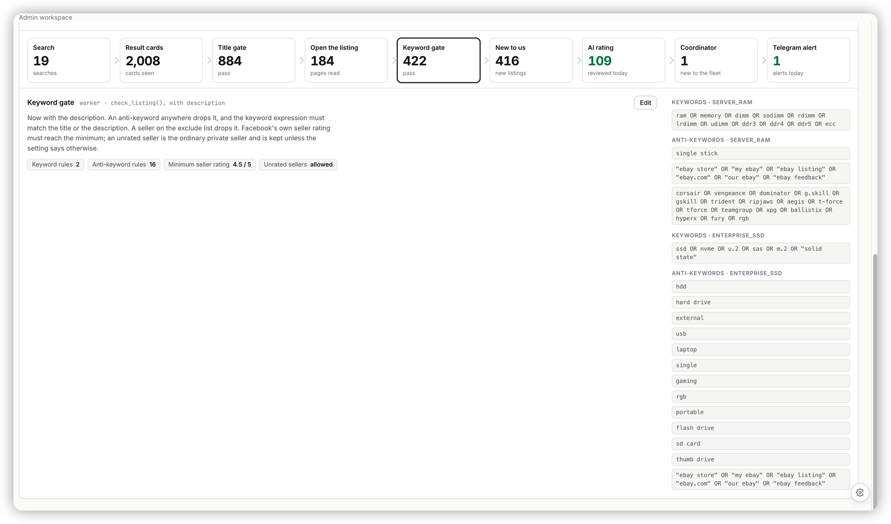

## Ask

> evaluate the UIUX of how to mamage the configuration in this section to make the configuration more user friendl to configure.
>
> [Image #1]
> Optimize the UIUX to better operate on them.

## Context

The *From a search to an alert* card (RS-263) lets a manager edit each stage's
settings, but the keyword lists were the hard part. Every rule showed as a
monospace box in a narrow side column, so a `corsair OR vengeance OR …` rule
read as a wall of `OR`s, and both items' lists ran into one long scroll. Edit
turned them into raw one-per-line textareas, which meant hand-typing `OR`s and
quotes. Nothing flagged a duplicate. There was no way to see what a change
would do before saving, and a save starts a sweep on every worker. Clicking
another stage mid-edit dropped the draft without asking. The Title gate also
printed an empty "Keywords" heading.

The monitor's matcher (`ai_marketplace_monitor/utils.py` `is_substring`) sets
the rules. A list is an OR over its entries. An entry may use NOT > AND > OR,
parentheses and quoted phrases. Terms match case-insensitively where a word
starts.

## Acceptance criteria

- [ ] Rule stages show one item at a time, picked from tabs that carry each item's rule counts. Keywords and anti-keywords sit side by side in a wide pane.
- [ ] Single-term rules show as a chip cloud. An OR rule shows as a group of chips. An AND/NOT/parenthesised rule shows as one chip tagged as an expression.
- [ ] A term repeated within one list is flagged.
- [ ] In edit mode, terms are added with Enter (or by pasting lines) and removed with ×. A term can be added to an existing OR group, and an expression can be edited in place. "Edit as text" falls back to the textarea.
- [ ] A rule nobody touched saves exactly as it was loaded.
- [ ] A "Try a listing" box on the Title and Keyword gates says, for each item, whether a title (plus description) passes, which anti-keyword drops it, or that no keyword matched. It reads the unsaved draft while editing.
- [ ] Save stays disabled until something changed, and shows how many changes there are. Switching stage, Cancel, navigating away or reloading with unsaved edits asks first.
- [ ] The Title gate no longer shows an empty Keywords heading.

## Out of scope

No tracker or backend change. The saved shape stays a list of strings per item
field. There is no structured builder for AND/NOT expressions; those are edited
as text.

## Notes

Plan: `~/.claude/plans/radiant-skipping-dahl.md`. RS-265 fixed the stage
detail at 300px tall while reading, so the rules use a wider right pane, not
a full-width section below.
