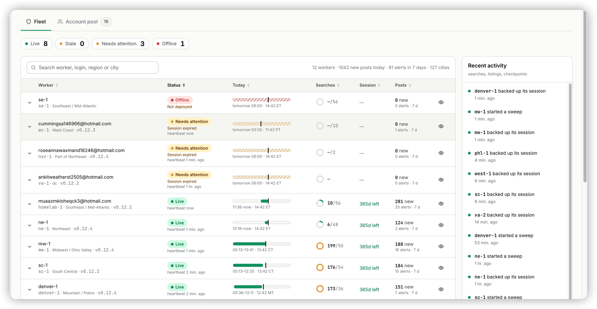

## Ask

> [Image #1]
>
> The recent activities shoudl capture when the woker status get changed.

## Context

Monitors ▸ Facebook ▸ Fleet's Recent activity (`ActivityAside` in
`FleetWorkers.tsx`) is rebuilt in the browser by `fleetActivity()`
(`lib/fleetView.ts`) from the timestamps the fleet doc happens to carry: each
worker's latest search, listing and session backup, a dead worker's last
heartbeat, and the open checkpoints. It cannot show a status change because
nothing records one. The coordinator overwrites `workers.state` on every
heartbeat (`rs_coordinator/routers/health.py`), works liveness out on read
(`health.py`, live under 2 h, stale under 6 h, dead after), and sends its
state-change alerts straight to Telegram without keeping them. So when three
workers flipped to *Needs attention · Session expired*, the feed only showed
backups and sweeps.

The ERP stores nothing about the fleet (it proxies rs_console), so the log has
to live in the coordinator and reach the ERP through `/v1/fleet`.

## Acceptance criteria

- [ ] The coordinator appends a row when a worker's reported state changes,
  and when its liveness crosses live → stale → dead or comes back live,
  stamped at the real crossing time (last heartbeat + 2 h / + 6 h, the beat
  that revived it).
- [ ] Existing workers produce no burst of entries on deploy; a retired
  worker's silence is not logged.
- [ ] `GET /v1/stats/status-changes` returns the last 7 days, newest first;
  rs_console puts them in `/v1/fleet` as `status_changes`.
- [ ] Recent activity lists each change ("went stale", "went offline", "is
  reporting again", "needs attention: Session expired", "is healthy again")
  with the dot of the status it moved into.
- [ ] The worker page's History shows the same changes for that worker.
- [ ] Against a console without `status_changes`, the feed is unchanged (keeps
  "stopped reporting").
- [ ] Both database backends are covered by tests; the zh strings exist.

## Out of scope

- Session-expiry-window crossings (≤ 14 days left) as entries. Fleet sessions
  report about a year left, and an expired session arrives as the
  `SESSION_EXPIRED` state, which is logged.
- "Cleared a checkpoint" entries from resolved challenges: an ERP-only
  follow-up (the page fetches open challenges only).
- A per-worker status timeline beyond the History list.

## Notes

- Facts, not chips, are logged: the coordinator records raw `state` and
  liveness changes, and the ERP phrases them. The chip itself is the ERP's
  `fleetStatus()`, which a Python copy would drift from.
