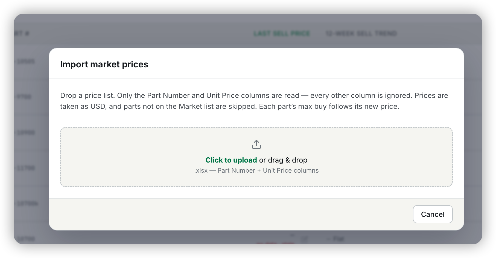

## Ask

> [Image #1]
>
> This should also able to adjust the price by the concurrency uds / yuan

## Context

The Market page's *Import market prices* dialog (RS-232, v1.247.0) reads a
sheet's Part Number and Unit Price columns and records each price as a market
data point. It takes every price as US dollars: a row whose cell, number
format, column header or tab names another currency is skipped as `not-usd`
("not priced in US dollars — the Market board is USD"). RS-232 left
"converting CNY prices" out of scope. So a supplier's yuan price list could not
be imported. A manager had to convert it by hand first.

The ERP already keeps a USD→CNY rate ledger (`fx_rates`, `lib/fx.ts`). A
Frankfurter refresh runs every 6 hours, and Settings → FX takes a manager
override. Sell orders priced in CNY convert through it, and their draft shows
the rate as `1 USD = N CNY (source)`.

## Acceptance criteria

- [x] The dialog has a USD / CNY (¥) switch, USD by default, above the drop
      zone and on the preview. Switching it on the preview re-reads the same
      file without a re-upload.
- [x] With CNY picked, an unmarked price is read as yuan and converted to
      US dollars at the ledger's latest rate, rounded to cents. The preview
      shows the USD price with the yuan amount under it, and shows the rate
      it used as `1 USD = N CNY (source)`.
- [x] A price that names its own currency is read in that currency whichever
      way the switch is set: `$`, `US$`, `USD` and 美元 as dollars, and `¥`,
      元, CNY and RMB as yuan. The name can come from the cell, its number
      format, the column header or the tab. So a `Unit Price (USD)` column
      is never converted, and a `¥` cell in a dollar list is converted
      instead of skipped.
- [x] A row priced in any other currency (HKD, EUR, GBP, JPY) is skipped,
      and the skip names its currency.
- [x] A yuan price that converts to less than a cent counts as no price, so
      Apply never sends a $0.00 price.
- [x] Apply records the USD prices the preview showed. The max buy follows
      them as before.

## Out of scope

- Recording the yuan amount or the rate on each price event. The event keeps
  the USD price and the file name, like any other import.
- Remembering the last currency picked between imports.
- Currencies other than USD and CNY. The FX ledger holds only USD→CNY.
- The phone Market tab, which has no import.

## Notes

- The reader (`readPriceSheetRows`, shared with the sell-order bid import) now
  reports `USD` for a dollar-marked row instead of `null`. Without that, an
  explicit dollar row and an unmarked one look the same, and a CNY import
  would convert a `Unit Price (USD)` column. The bid import does not read the
  field.
- A bare `$` reads as dollars except right after a letter (HK$, C$) or after
  `[` (Excel's `[$€-407]` locale syntax in a number format).
- A text cell like `HK$80` or `€40` doesn't parse as a number at all, so it
  stays an invalid price, as before. Only a currency named by a number format,
  header or tab reaches the other-currency skip.
- `CurrencyPicker` moved from `DesktopSellOrderDraft.tsx` to
  `components/CurrencyPicker.tsx`. Importing it from the draft page would
  have pulled that page's module into the Market chunk.
- Verified on the local stack with a supplier sheet at the dev ledger's
  6.6862: ¥720 previewed and applied as $107.68 (max buy $75.38), a `$15` cell
  stayed $15.00, and a euro-formatted row was skipped as "priced in EUR".
- RS-300 and v1.285.0 were taken by another session mid-flight, so this
  ticket was renumbered from RS-300.
