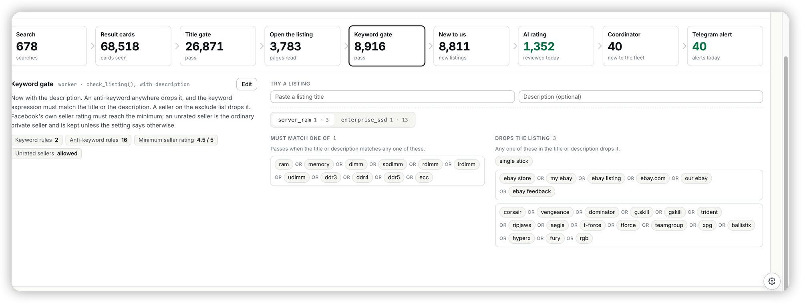

## Ask

> [Image #1]
>
> pls optimize the UI operation here.
> Two type of keywords.
> one is for include, another is for exclude.

## Context

The Keyword gate and Title gate on Monitors ▸ Facebook ▸ *From a search to an
alert* show each item's keyword rules (`pages/desktop/FleetRules.tsx`). RS-269
(v1.270.0) turned them into chips, but the two kinds of keyword still read as
one mass:

- Include and exclude looked identical: the same grey chips and boxes, told
  apart only by a small uppercase label ("Must match one of" / "Drops the
  listing").
- Every count counted config lines, not keywords. "Must match one of 1" sat
  above 12 chips and "Drops the listing 3" above 29. The item tabs
  (`server_ram 1 · 3`) and the stage pills (`Keyword rules 2`, `Anti-keyword
  rules 16`) worked the same way.
- An "or" sat between every chip, about forty of them, though every list
  already means "any one of these". The bordered boxes around groups only
  mirror how the config happens to be split into lines, and `single stick`
  floated outside any box.
- Adding a keyword meant clicking Edit on the far left, then finding the input
  under the last chip on the right.

The matcher is unchanged: a list is an OR over its entries, an entry may be an
OR of terms or an AND/NOT expression, an exclude match drops the listing first,
and then one include keyword must match.

## Acceptance criteria

- [x] The Keyword gate shows two lists titled **Include** and **Exclude**,
  each with a +/− badge and a green or red tinted field. The Title gate shows
  only **Exclude**.
- [x] Lists are flat: no "or" words and no group boxes. An AND/NOT expression
  shows as one tagged chip.
- [x] A list's count, the item tabs (`+12 −29`) and the stage pills count
  keywords, not config lines.
- [x] In read mode, **+ Add keyword** opens Edit with that list's input
  focused. In edit mode, Enter or a pasted list adds keywords, × removes one,
  and *Edit as text* still works.
- [x] *Try a listing* fills the matched chip in its list's colour.
- [x] An include keyword that is also in Exclude is struck through, and its
  tooltip says why.
- [x] A rule nobody touched saves exactly as loaded.
- [x] At 800px and narrower the lists stack.

## Out of scope

No tracker, console or backend change, and the saved shape stays a list of
strings per field. There is no drag-and-drop between the lists and no
structured AND/NOT builder; expressions are still edited as text. The
rs_console's own `fleet.js` page is left as it is.

## Notes

Plan: `~/.claude/plans/quiet-crunching-toucan.md`. New keywords are appended as
new lines rather than folded into an existing OR line. The meaning is the same,
and it keeps every untouched line byte-for-byte.

The ERP has a light theme only, so the plan's dark-theme check was dropped.
Verified against a local coordinator, console and ERP with Playwright. The
include and exclude fields render, a probe fills `corsair` in Exclude and
`memory` in Include, and **+ Add keyword** focuses the right input. A save
(intercepted) carried `server_ram.antikeywords` with only the touched line
rewritten and the two new lines appended. Every other list was byte-identical.
