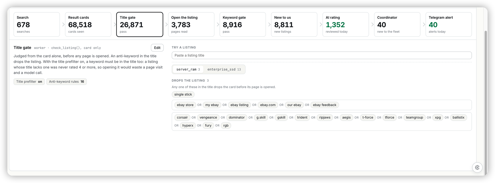

## Ask

> [Image #1]
> UI UX optimize for this keywords managements.

Then, on the three gaps left after RS-304:

> yes, and start the implementation

## Context

RS-304 (v1.288.0) split the keyword rules on Monitors ▸ Facebook ▸ *From a
search to an alert* into green **Include** and red **Exclude** lists
(`pages/desktop/FleetRules.tsx`). That request was raised in a parallel session
while this one was being planned. Three gaps it left were still visible when
run against the real `master.toml`:

- **The Title gate hides the Include list it uses.** With the title prefilter
  on, the monitor's `check_listing()` drops a card whose title has no include
  keyword. *Try a listing* says so ("No include keyword matched: dropped"), but
  the list it failed against can't be seen or edited on that stage, since
  `STAGE_LISTS.title` is `['antikeywords']` only.
- **The tester doesn't say *where* a word matched.** The verdicts sit in a
  separate row of grey pills above the item tabs, and only the first hit lights
  up, so a title that hits both lists shows half the story.
- **The strike-through only catches exact copies.** Matching starts at a word
  but stays open at the end. So `ram` in Exclude drops every listing with an
  Include keyword `ram stick` (or `rams`), and that keyword can never let a
  listing through. RS-304 strikes only a keyword spelled identically in both
  lists.

## Acceptance criteria

- [x] The Title gate shows Include beside Exclude, as the Keyword gate does,
  and its Edit form edits and saves both lists.
- [x] With the title prefilter off, the Title gate's Include list is dimmed,
  and a note says the keyword gate checks it after the page is read.
- [x] While a listing is typed into *Try a listing*, each item tab carries that
  item's verdict. The separate verdict row is gone. With a single item, its tab
  still shows.
- [x] Under the tabs, the typed title (and on the Keyword gate the description)
  is shown with every Include word marked green and every Exclude word marked
  red, for the selected item.
- [x] Every chip whose keyword is in the typed listing fills in its list's
  colour, not just the first hit.
- [x] An Include keyword that an Exclude keyword always catches is struck
  through, and its tooltip names that Exclude keyword. This covers exact copies
  and words that merely start with it.
- [x] A rule nobody touched still saves byte-for-byte, and the title and stage
  pills count Include keywords too.

## Out of scope

No tracker, console or backend change, and the saved shape doesn't change.
Words inside an AND/NOT expression aren't marked in the title; the expression
chip still lights up when it matches. No structured expression builder.

## Notes

Plan: `~/.claude/plans/cryptic-tinkering-candy.md`. It was written before
RS-304 landed, and only the three gaps above survived.

- While the title prefilter is off, the Title gate's Include list is dimmed.
  Its words are then neither marked in the title nor filled in, because that
  stage doesn't read them.
- A matched include chip still fills when an exclude keyword drops the
  listing. "It would have passed, but for this" is part of the answer, and
  the tab names the keyword that decided.
- The shadow check is `containsTerm(exclude, include)`. A listing that holds
  the include keyword where a word starts then holds the exclude keyword
  where a word starts too.
- Verified against a local coordinator, console and ERP with Playwright.
  - Both rule stages showed tab verdicts and title marks.
  - Unticking the prefilter dimmed Include.
  - Adding `rgb ram` on the Keyword gate struck it through, caught by `rgb`.
  - A save from the Title gate after **+ Add keyword** focused Include sent
    both lists with only `ram kit` appended. Every other line was
    byte-identical to `master.toml`.
